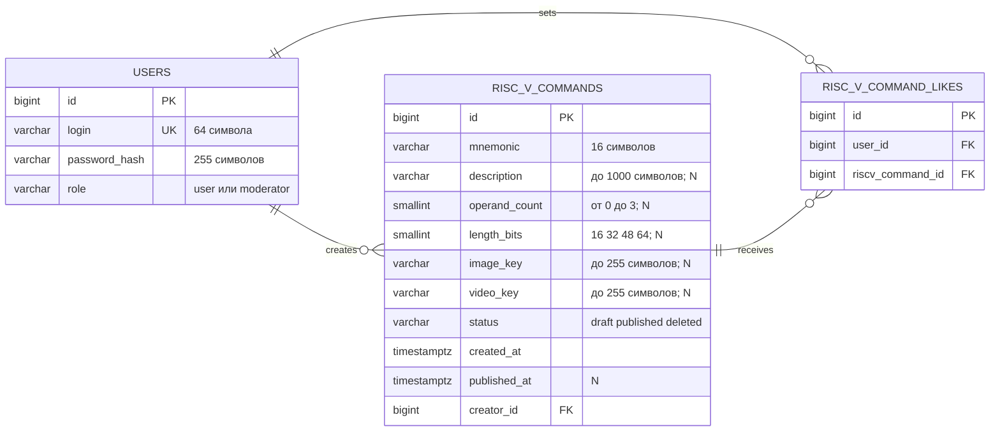

# Сценарий демонстрации ЛР2

## Подготовка

1. Выполнить `make lab2-run` из корня проекта.
2. Открыть приложение на `http://localhost:8080/riscv_commands/feed`.
3. Открыть Adminer на `http://localhost:8081`.
4. Выбрать систему `PostgreSQL`, сервер `postgres` и параметры подключения из `backend/docker/.env`.

Начальные пользователи, команды и лайки добавляются миграцией. Adminer используется для выполнения подготовленных ниже проверочных команд.

## Схема данных

Схема приведена как есть и соответствует применённым миграциям. Редактируемая диаграмма draw.io находится в файле [`ER.drawio`](ER.drawio).



Пометка `N` означает поле, которое после нажатия «Далее» может быть `NULL`. У нового черновика это описание, количество операндов, длина команды, ключи медиа и дата публикации.

## Скриншоты 1–2: логическое удаление в Adminer

Выполнить:

```sql
UPDATE riscv_commands
SET status = 'deleted'
WHERE id = 4;

SELECT id, mnemonic, status, operand_count, length_bits, image_key, video_key
FROM riscv_commands
ORDER BY id;
```

На первом скриншоте показать выполненный `UPDATE`, на втором — строку команды `SUB` со статусом `deleted` в результате `SELECT`.

## Скриншоты 3–10: работа приложения

1. На странице плитки выбрать диапазон количества операндов и нажать «Показать».
2. Удалить опубликованную команду кнопкой «Удалить».
3. Открыть прежний URL удалённой команды и показать ответ «Команда не найдена».
4. На странице добавления указать мнемонику `LW`, выбрать фото и видео и нажать «Далее». Выбранные файлы не передаются на сервер.
5. Проверить создание черновика в Adminer:

```sql
SELECT id, mnemonic, status, image_key, video_key, created_at, published_at
FROM riscv_commands
WHERE mnemonic = 'LW'
ORDER BY id DESC
LIMIT 1;
```

Поля `image_key` и `video_key` нового черновика должны быть `NULL`.

6. На той же странице заполнить описание, количество операндов `2` и длину команды `32` бита.
7. Нажать «Опубликовать» и показать переход в ленту.
8. Проверить публикацию в Adminer:

```sql
SELECT id, mnemonic, description, operand_count, length_bits, status, published_at
FROM riscv_commands
WHERE mnemonic = 'LW'
ORDER BY id DESC
LIMIT 1;
```

## Скриншоты 11–13: изменение данных через Adminer

Изменить мнемонику и оба предметных поля опубликованной команды, сохранив согласованность данных:

```sql
UPDATE riscv_commands
SET mnemonic = 'SW', operand_count = 3, length_bits = 32
WHERE id = (
    SELECT id
    FROM riscv_commands
    WHERE mnemonic = 'LW' AND status = 'published'
    ORDER BY id DESC
    LIMIT 1
);
```

Добавить лайк текущей команде:

```sql
INSERT INTO riscv_command_likes (user_id, riscv_command_id)
SELECT 2, id
FROM riscv_commands
WHERE mnemonic = 'SW' AND status = 'published'
ORDER BY id DESC
LIMIT 1
ON CONFLICT (user_id, riscv_command_id) DO NOTHING;
```

Проверить предметные поля и количество лайков:

```sql
SELECT
    command.id,
    command.mnemonic,
    command.operand_count,
    command.length_bits,
    COUNT(command_like.id) AS like_count
FROM riscv_commands AS command
LEFT JOIN riscv_command_likes AS command_like
    ON command_like.riscv_command_id = command.id
WHERE command.mnemonic = 'SW'
GROUP BY command.id
ORDER BY command.id DESC;
```

Обновить ленту и плитку и показать изменившиеся поля и счётчик лайков.

Для демонстрации удаления строки связи многие-ко-многим выполнить:

```sql
DELETE FROM riscv_command_likes
WHERE user_id = 2
  AND riscv_command_id = (
      SELECT id
      FROM riscv_commands
      WHERE mnemonic = 'SW'
      ORDER BY id DESC
      LIMIT 1
  );
```

## Скриншоты 14–21: код

Показать:

1. модель `RiscVCommand` с двумя предметными полями `Format` и `OperandCount` и атомарным полем `LengthBits`;
2. SQL-миграции трёх таблиц;
3. три GET-контроллера;
4. POST создания черновика без приёма медиафайлов;
5. POST публикации;
6. GORM-запросы репозитория;
7. параметризованный SQL `UPDATE` в `SoftDelete`;
8. регистрацию ровно шести прикладных HTTP-методов.

## Скриншот 22: медиа по умолчанию в HTML

Открыть опубликованную команду `SW` с пустыми `image_key` и `video_key`. В HTML-ответе показать локальные адреса SSR-сервера:

```html

<source src="/defaults/video.mp4" type="video/mp4">
```

Для проверки fallback при недоступном объекте временно указать несуществующие ключи:

```sql
UPDATE riscv_commands
SET image_key = 'images/missing.png',
    video_key = 'video/missing.mp4'
WHERE mnemonic = 'SW';
```

После обновления страницы HTML также должен содержать `/defaults/image.svg` и `/defaults/video.mp4`.
