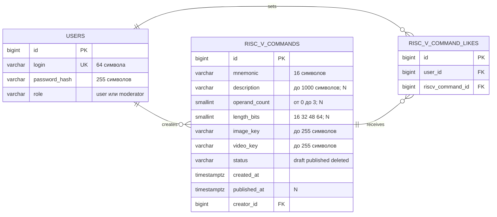

# ER-диаграмма

Диаграмма соответствует миграциям из `internal/migration/sql`. Редактируемая версия доступна в формате [draw.io](ER.drawio) и свёрстана под лист A4 в книжной ориентации: связи проведены от первичных ключей к соответствующим внешним ключам без пересечений. Ниже сохранено независимое текстовое представление схемы.

## Ограничения схемы

- `users.login` — уникальное поле;
- пара `(user_id, riscv_command_id)` — уникальная;
- для каждого `creator_id` допускается не более одной строки `riscv_commands` со статусом `draft`;
- `riscv_commands.status` принимает только `draft`, `published`, `deleted`;
- все внешние ключи используют ограничение удаления `RESTRICT`, каскадное удаление запрещено;
- `published_at` обязателен для опубликованной команды;
- пометка `N` у полей команды означает, что они допускают `NULL` для черновика;
- `operand_count` и `length_bits` — два предметных поля команды RISC-V;
- `image_key` и `video_key` (url изображения и видео) обязательны: `NOT NULL` и непустые значения. Для черновика, созданного без файлов, сохраняются ключи заведомо отсутствующих объектов `images/missing/…` и `video/missing/…`;
- для пустых ключей и недоступных объектов SSR-сервер подставляет локальные фото и видео по умолчанию.
