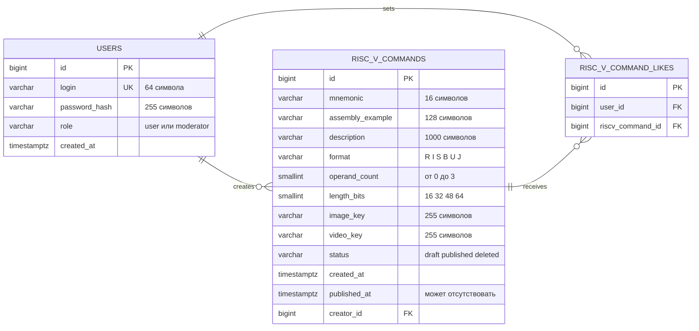

# ER-диаграмма ЛР2

Диаграмма соответствует миграциям из `internal/migration/sql`. Готовый проект для открытия и дальнейшего оформления в StarUML находится в файле [`ER.mdj`](ER.mdj); ниже сохранено независимое текстовое представление схемы.

## Ограничения схемы

- `users.login` — уникальное поле;
- пара `(user_id, riscv_command_id)` — уникальная;
- для каждого `creator_id` допускается не более одной строки `riscv_commands` со статусом `draft`;
- `riscv_commands.status` принимает только `draft`, `published`, `deleted`;
- все внешние ключи используют ограничение удаления `RESTRICT`, каскадное удаление запрещено;
- `published_at` обязателен для опубликованной команды;
- `image_key` и `video_key` содержат только ключи объектов MinIO.
